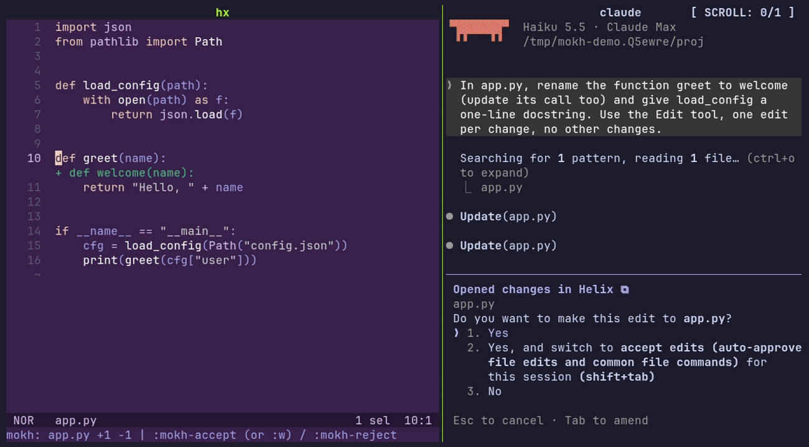

# mokh.hx

Claude Code IDE integration for [Helix](https://helix-editor.com), as a
[Steel](https://github.com/mattwparas/steel) plugin. Moss on the forest floor.



*A real Claude Code (Haiku) session on the right, connected through `/ide`. Its
edits show up inline in the buffer on the left: the deleted line highlighted,
the added line as a green row under it. `space m a` accepts, `space m r`
rejects. Rendered from `docs/demo.tape` with VHS; `docs/demo/run.sh` sets
up the throwaway project and the isolated Claude config it uses.*

Claude Code can attach to an editor the way it attaches to VS Code or
JetBrains: it learns what you have selected, opens files for you, and shows
each edit as a diff you accept or reject before it is written. mokh.hx gives
Helix that protocol. Claude keeps running in its own terminal (a zellij or
tmux pane next to `hx` is the intended setup); only the review loop moves
into the editor.

Status: alpha. The protocol works end to end against a simulated client and
the real CLI; the diff UI is the first, split-based version.

## What you get

- `/ide` in Claude Code lists **Helix** and connects to it.
- `:mokh-send` pushes the current selection to Claude as an `@`-mention,
  `:mokh-send-file` the whole file. Live selection tracking
  (`selection_changed`) is available but off by default.
- `openFile` from Claude opens the file in Helix and jumps to the text it
  names.
- `openDiff` shows Claude's proposed change **inline in the real buffer**:
  lines it deletes get a red background, lines it adds appear as green rows
  under the line they follow, and the cursor lands on the first hunk.
  `:mokh-next-hunk` / `:mokh-prev-hunk` move between hunks. `:mokh-accept`
  sends the proposal back and Claude writes the file; `:mokh-reject` refuses
  it. `:mokh-edit` opens the proposal as an editable buffer when you want to
  change it first; `:w` there accepts with your edits. Without the hx patch
  below, the same flow uses a unified diff in a vertical split instead.
- Open editors, dirty state, save-on-request and diff-tab cleanup, so the
  CLI's bookkeeping works.

## Requirements

- Helix built from the Steel branch
  (`mattwparas/helix`, `steel-event-system`), see its
  [STEEL.md](https://github.com/mattwparas/helix/blob/steel-event-system/STEEL.md).
- `mokh-bridge` on your `PATH` (or point the plugin at it, see below). It is
  a small Rust program; build it with `cargo build --release` in `bridge/`,
  or `nix build .#mokh-bridge`.
- Claude Code.

## Install

With forge:

```sh
forge pkg install --git https://github.com/vitaliikindrat/mokh.hx.git
```

With Nix, the flake exposes `packages.<system>.mokh` (the cog, with
`passthru.cogName = "mokh"` so
[helix-plugins-nix](https://github.com/maxschipper/helix-plugins-nix) can
install it) and `packages.<system>.mokh-bridge`.

Then in `~/.config/helix/init.scm`:

```scheme
(require "mokh/mokh.scm")

;; Optional. Defaults: "mokh-bridge" from PATH, IDE name "Helix",
;; proposals under /tmp/mokh-hx, selection tracking off (with it on, Claude's
;; prompt shows "in <file>" for whatever buffer is focused).
(mokh-configure! #:bridge "/path/to/mokh-bridge"
                 #:ide-name "Helix"
                 #:track-selection #f)

;; Start on launch, or bind :mokh-start to a key and start on demand.
(mokh-start)

(require (only-in "helix/keymaps.scm" keymap))
(keymap (global)
        (normal (space (m (s ":mokh-send")
                          (f ":mokh-send-file")
                          (a ":mokh-accept")
                          (r ":mokh-reject")
                          (e ":mokh-edit")
                          (n ":mokh-next-hunk")
                          (p ":mokh-prev-hunk")
                          (i ":mokh-status")))))
```

Restart Helix. In Claude Code, run `/ide` and pick Helix. The status line
reports `mokh: Claude Code connected`.

## Commands

| Command | What it does |
| --- | --- |
| `:mokh-start` | Start the bridge for the current workspace (writes the lock file Claude's `/ide` reads) |
| `:mokh-stop` | Stop it; pending diffs are rejected, the lock file removed |
| `:mokh-status` | Port, attached Claude sessions, pending diffs |
| `:mokh-send` | Send the primary selection to Claude as an `@`-mention (file and line range) |
| `:mokh-send-file` | Send the focused file to Claude as an `@`-mention |
| `:mokh-accept` | Accept the diff under the cursor (or the only pending one) with the proposal buffer's current text |
| `:mokh-reject` | Reject it |
| `:mokh-edit` | Open the proposal as an editable buffer (in the diff window, or a split next to an inline review); its text is what accept sends |
| `:mokh-next-hunk`, `:mokh-prev-hunk` | Move between hunks of an inline review |

`:w` inside a proposal buffer accepts, like the VS Code extension.

## How it works

```
Claude Code  <-- WebSocket / MCP -->  mokh-bridge  <-- JSON lines on stdio -->  mokh.scm in hx
   /ide            lock file in                 (Rust, tokio)                 (Steel, UI thread)
                 ~/.claude/ide/
```

- `bridge/` is the Rust sidecar. It writes `~/.claude/ide/<port>.lock`,
  serves the WebSocket with the token check Claude expects, answers the MCP
  handshake and `tools/list`, computes the unified diff for `openDiff`, and
  forwards every editor-facing tool to Helix as one JSON line, pairing the
  reply back to the right request. It exits when the editor goes away and
  removes its lock file.
- `mokh.scm` spawns the bridge, reads its stdout on a native thread, and
  runs each request on the editor thread through `hx.with-context`. It
  answers from editor state and pushes `selection_changed` from the
  `selection-did-change` hook.
- `util.scm` is the pure part: JSON shapes and string helpers, tested with
  plain `steel`.

The protocol is the one the VS Code extension speaks, documented by the
Neovim implementation in
[coder/claudecode.nvim/PROTOCOL.md](https://github.com/coder/claudecode.nvim/blob/main/PROTOCOL.md).
It is unofficial; when Anthropic changes it, this follows.

## Inline review and the hx patch

Helix core has no multi-line virtual text, so the inline rendering needs a
small addition to the Steel fork: a per-document store of virtual rows and
line highlights, one `LineAnnotation` that reserves the rows (so cursor
movement and scrolling skip them, like inline diagnostics) and one
`Decoration` that paints them, exposed to Steel as `add-virtual-lines`,
`add-line-highlight`, `remove-virtual-text` and `clear-virtual-text` in
`helix/misc.scm`. It lives in [dna.hx](https://github.com/vitaliikindrat/dna.hx)
as `helix-virtual-text.patch` (about 350 additive lines, against
`mattwparas/helix` at `424add1`), with the other Steel plugin APIs. Apply it
to your Steel build; with Nix, add `inputs.dna.patches.virtual-text` to
the derivation's `patches`. The plugin
detects the API at load time and falls back to the split view without it;
`(mokh-configure! #:inline #f)` forces the split view.

The rows use the theme scopes `ui.virtual.diff.minus` and
`ui.virtual.diff.plus` for the backgrounds and `diff.minus` / `diff.plus` for
the text, which every theme has. With dna.hx's `helix-theme.patch` the
backgrounds are inherited from any theme (a fifth of `diff.minus` /
`diff.plus` over its background, again on every theme change); a theme can
set them itself, e.g. `bg = "#3b1d22"` and `bg = "#1b3324"`.

## Tools

| Tool | Answered by |
| --- | --- |
| `getWorkspaceFolders` | bridge |
| `openFile`, `getCurrentSelection`, `getLatestSelection`, `getOpenEditors`, `checkDocumentDirty`, `saveDocument` | Helix |
| `openDiff`, `close_tab`, `closeAllDiffTabs` | Helix |
| `getDiagnostics` | Helix, but always empty: Steel exposes diagnostic counts only |
| `executeCode` | refused (Jupyter only) |

## Development

```sh
cd bridge && cargo test                 # unit + protocol tests (fake Claude over a real socket)
steel tests/util-test.scm               # pure Scheme tests
nix flake check                         # both
```

`claude-sim` is a stand-in for the CLI: it finds the newest lock file,
connects like Claude does, and runs tool calls from the command line. Start
`hx` with the plugin, then:

```sh
cargo run --example claude-sim -- list-tools \
  call openFile '{"filePath":"/path/to/file","startText":"fn main"}' \
  listen 3 \
  call openDiff '{"old_file_path":"/path/to/file","new_file_path":"/path/to/file","new_file_contents":"...","tab_name":"demo"}'
```

The last call blocks until you `:mokh-accept` or `:mokh-reject` in Helix.

## Roadmap

- Hunk-level accept and reject, with a note back to Claude about what was
  reverted (the odiumuniverse/claudecode.nvim idea).
- Upstream the virtual-text patch to the Steel branch.
- Review-after-write for auto-accept mode, driven by Claude Code hooks.
- Real diagnostics once the Steel API exposes them.

## License

MIT.
